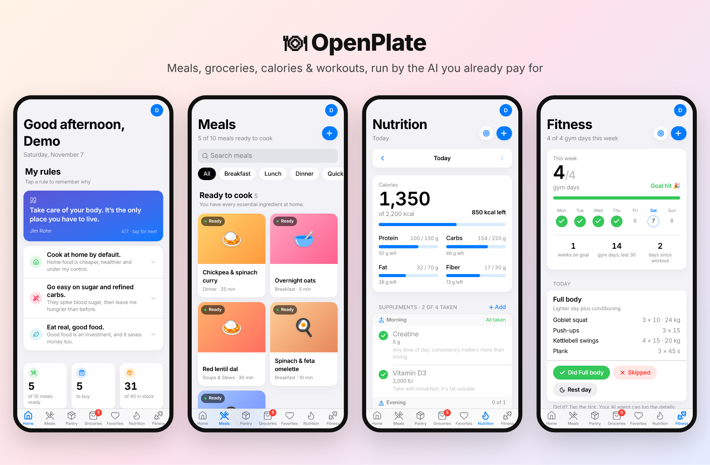

<div align="center">

# 🍽 OpenPlate

**Your meals, pantry, groceries, calories, workouts and supplements, run by the AI you already pay for.**

An open-source, MCP-first alternative to paid nutrition and meal-planning apps.
Self-host it for free in one prompt, talk to it from Claude, ChatGPT, Gemini or any MCP client, and keep every byte of your data.

**[▶ Live demo](https://openplate-puce.vercel.app)** · [One-prompt install](#-one-prompt-install) · [What it does](#-what-it-does) · [How it works](#-how-it-works) · [Connect your AI](#-connect-your-ai) · [Architecture](docs/ARCHITECTURE.md)


</div>

[](https://openplate-puce.vercel.app)

---

## Why

Calorie-tracking and meal apps charge a monthly subscription to do what a
good AI model already does well: understand "two eggs on toast and a
coffee", estimate the macros, and tell you what you can cook tonight. But
your AI chat can't remember your pantry or last week's food log, and each
app keeps your history locked inside it.

OpenPlate splits the job in two:

- **A small app you own** (free Supabase + Vercel) stores the facts: meals
  and recipes, what's in the pantry, the grocery list, the food log, goals,
  workouts, weight and supplements.
- **The AI you already use** does the thinking, through an
  [MCP](https://modelcontextprotocol.io) connector: it reads the live data,
  answers questions, coaches you and logs things for you.

| | Subscription nutrition apps | OpenPlate |
| --- | --- | --- |
| Price | Monthly subscription | $0 (your existing AI plan + free tiers) |
| AI | Their model, their prompts | Any model you like: Claude, ChatGPT, Gemini, others |
| Switch AI apps | Start over | Paste the same URL; all history comes with you |
| Your data | Their servers | Your own Postgres database, export any time |
| Scope | Calories | Calories **and** pantry, recipes, groceries, workouts, weight, supplements |
| Customise | No | Fork it, edit the agent guide, change anything |

## ✨ What it does

**Talk to it** (from any connected AI):

> "I had two eggs on toast and a latte for breakfast."
> → logs it with calories and macros, tells you what's left for the day.

> "What can I cook tonight with what I have?"
> → ranks your saved meals by what's actually in stock.

> "I just got back from the store: eggs, spinach, chicken, rice."
> → marks them in stock and ticks them off the grocery list.

> "Build me a 4-day push/pull/legs plan for Mon, Tue, Thu, Sat."
> → saves the routines; the app shows today's workout and your streak.

> "How am I doing this week?"
> → combines food log vs goals, training days, weight trend and supplements.

**Or tap through the app** (installable PWA, iOS-style, light and dark mode):

- **Home**: what you can cook tonight, meals one shop away, best next buys,
  this week's training, your food rules.
- **Meals**: every recipe sorted by readiness (*Ready*, *Almost there*,
  *Needs shopping*), with ingredients, photos and nutrition per serving.
- **Pantry**: in stock / out, by aisle, bulk restock.
- **Groceries**: one list, grouped by aisle; picking something up marks it
  in stock.
- **Favorites**: dishes and restaurants by cuisine, rated, with notes.
- **Nutrition**: calories, protein, carbs, fat and fibre vs daily goals, a
  food log, a 7-day chart, and a supplements tracker.
- **Fitness**: gym days vs a weekly goal, streaks, a calendar of ✓ and ✗,
  the workout plan, and body weight.

Everything stays in sync: the app and every connected AI read and write the
same live data.

## 👀 Try the demo

The demo runs the real app on made-up sample data, entirely in your browser:
no account needed, nothing is saved, and it resets on reload.

**👉 [openplate-puce.vercel.app](https://openplate-puce.vercel.app)** (best on a phone; add it to your home screen)

**Host a demo yourself:** import this repo on [Vercel](https://vercel.com/new),
add the environment variable `VITE_DEMO=true` (no Supabase needed), and
deploy. The sample data lives in `src/demo/`.

## 🚀 One-prompt install

You need free accounts on [GitHub](https://github.com),
[Supabase](https://supabase.com) and [Vercel](https://vercel.com), plus an
AI coding agent that can run commands (Claude Code, Codex, Cursor, Gemini
CLI, …). Paste this:

```text
Install OpenPlate for me from https://github.com/farhan1301/openplate.
Follow INSTALL.md in that repo step by step: fork it to my GitHub, create a
free Supabase project, run the migrations, deploy it to Vercel, and set up
sign-in. Ask me for my email and time zone, and tell me when I need to log in
or click something.
```

About 10 minutes later you have your own app at `https://<you>.vercel.app`
and an MCP URL to add to your AI. Prefer doing it by hand? [INSTALL.md](INSTALL.md)
works for people too.

## 🔌 Connect your AI

In the app: **profile picture → AI Access → Create key**. Keys are
read-only unless you turn on **Can make changes**, and can be revoked any
time. Then add the URL it gives you:

| Client | How |
| --- | --- |
| Claude (web, desktop, mobile) | Settings → Connectors → Add custom connector |
| Claude Code | `claude mcp add --transport http openplate "<URL>"` |
| ChatGPT | Settings → Connectors / Apps → developer mode → add MCP server |
| Gemini CLI, Cursor, VS Code, … | Add a remote HTTP MCP server |
| Any chat without MCP | AI Access → **Copy guide + snapshot**, paste into the chat |
| Scripts / automations | Plain HTTP: `GET /api/agent/snapshot?key=…`, `POST /api/agent/write` |

**Tools exposed:** `get_kitchen_guide`, `get_kitchen_snapshot`,
`get_nutrition`, `get_fitness`, `get_supplements`, plus write tools for the
pantry, grocery list, meals, favorites, food log, nutrition goals, workouts,
workout plan, body weight, supplements, your "About me" profile and the
agent guide itself. Every change an agent makes is shown in the app under
**Recent agent changes**.

## 🧠 How it works

```
 Claude / ChatGPT / Gemini / any MCP client          You, in the browser
                │  MCP over HTTPS (?key=…)                    │
                ▼                                             ▼
   Vercel: /api/mcp  /api/agent/*                 React app (Vite PWA)
     (stateless, no secrets)                        Supabase Auth (magic link)
                │  RPC with the agent key                     │
                ▼                                             ▼
   ┌──────────────── Supabase Postgres (yours) ────────────────┐
   │ meals · pantry · grocery list · favorites · food log      │
   │ goals · workouts · plan · weight · supplements            │
   │ About me · agent guide · hashed agent keys · audit log    │
   │ Row Level Security + an email allowlist on every table    │
   └───────────────────────────────────────────────────────────┘
```

- **The agent guide is the context.** `docs/MEALS_AGENT.md` tells any model
  what every field means, how meal readiness works and how to coach. You
  (or your agents) can edit it from the app and add house rules, and it
  lives in your database: switch from one AI to another and the new one
  reads the same guide, profile and history.
- **One snapshot, one call.** `get_kitchen_snapshot` returns your profile,
  meals with readiness, pantry, grocery list, today's nutrition, this week's
  training and today's supplements as one JSON document, so an agent can
  answer most questions in one round trip.
- **Same rules everywhere.** Writes go through Postgres functions that apply
  the app's sync rules (buying something removes it from the list, deleting
  a meal drops its unbought groceries), so agents can't leave the data in a
  state the app wouldn't.
- **Secure by default.** Only a SHA-256 hash of each agent key is stored.
  The Vercel functions use only the public Supabase key; the database
  checks the agent key and its permissions itself. Signed-in access is
  limited to allowlisted emails by Row Level Security.

## 🛠 Tech stack

React 19 · Vite · Tailwind CSS 4 · Supabase (Postgres, Auth, Storage, RLS) ·
Vercel serverless functions · Model Context Protocol (stateless HTTP) ·
lucide-react

## 💻 Development

```bash
cp .env.example .env     # add your Supabase URL and public key
npm install
npm run dev              # http://localhost:5173
npm run lint && npm run build
```

- Database: `supabase/migrations/` (apply in order; see [INSTALL.md](INSTALL.md))
- API + MCP server: `api/`
- Agent guide: `docs/MEALS_AGENT.md`
- How everything fits: [docs/ARCHITECTURE.md](docs/ARCHITECTURE.md)
- A Claude Code skill for answering food questions from your data:
  `.claude/skills/meals-assistant`

Make it yours: the food rules on Home live in `src/lib/principles.js`, the
time zone in `meals_settings`, and the agent's behaviour in the guide
(editable in the app under AI Access).

## 🤝 Contributing

Issues and pull requests are welcome. Good first areas: photo food logging
through the agent, data export, multi-user households, more MCP clients in
the docs, translations. Please run `npm run lint` and `npm run build`
before opening a PR, and keep `docs/MEALS_AGENT.md` in sync with any
snapshot or tool change.

## ⚠️ Disclaimer

OpenPlate and the AI agents connected to it are not medical advice. Talk
to a doctor or registered dietitian about diets, supplements and injuries.

## 📄 License

[MIT](LICENSE)
